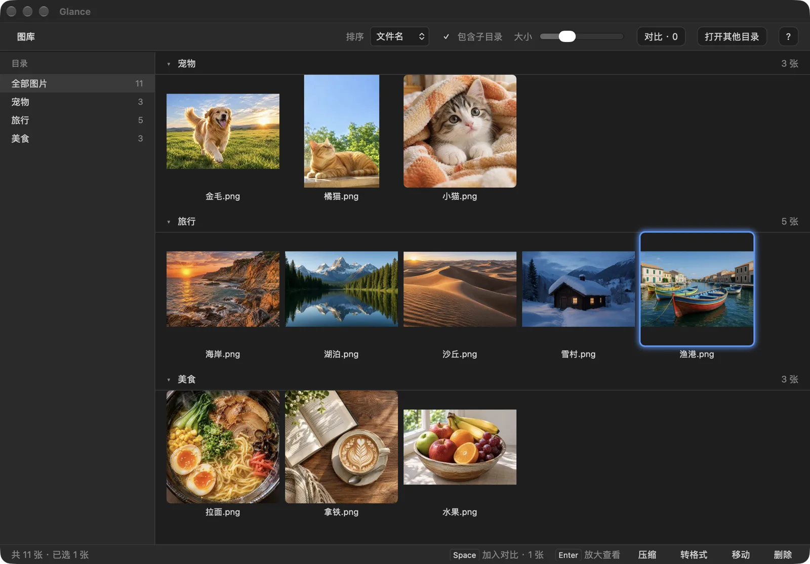
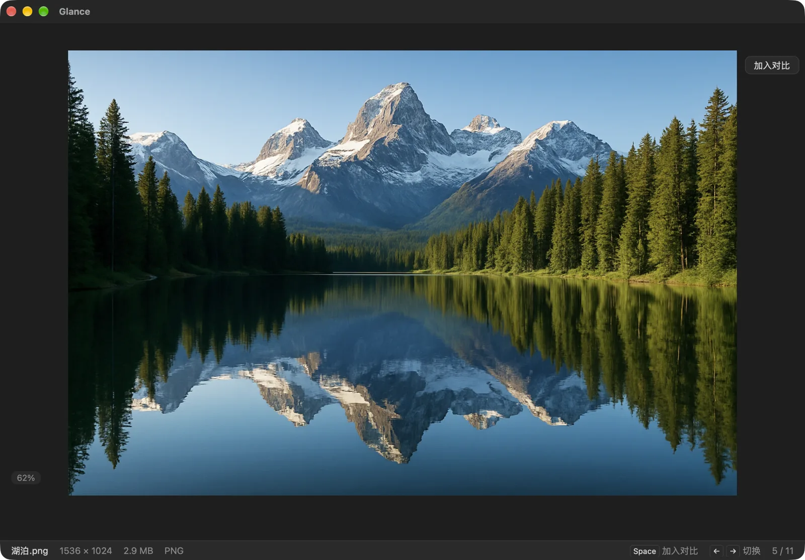
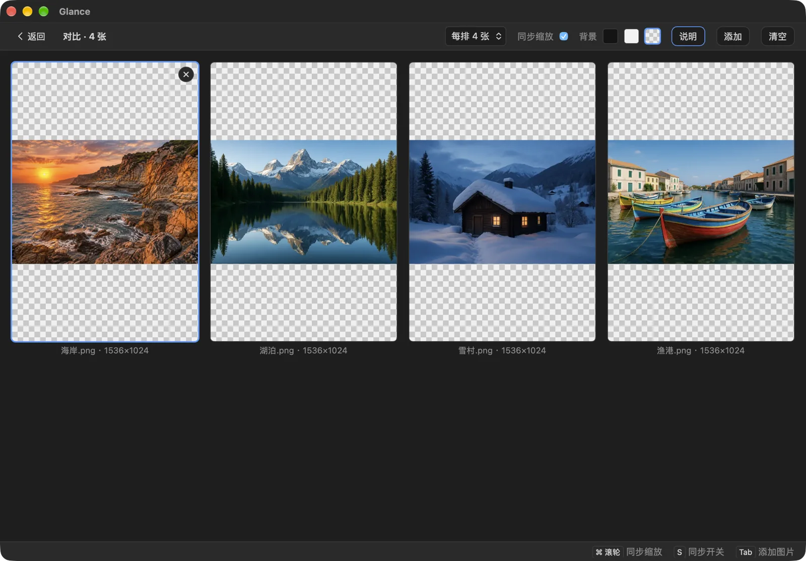
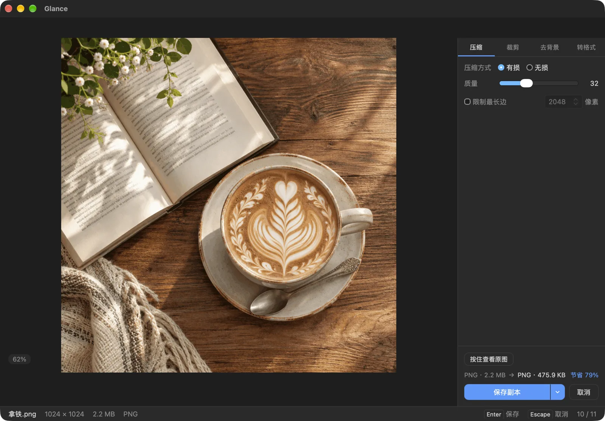
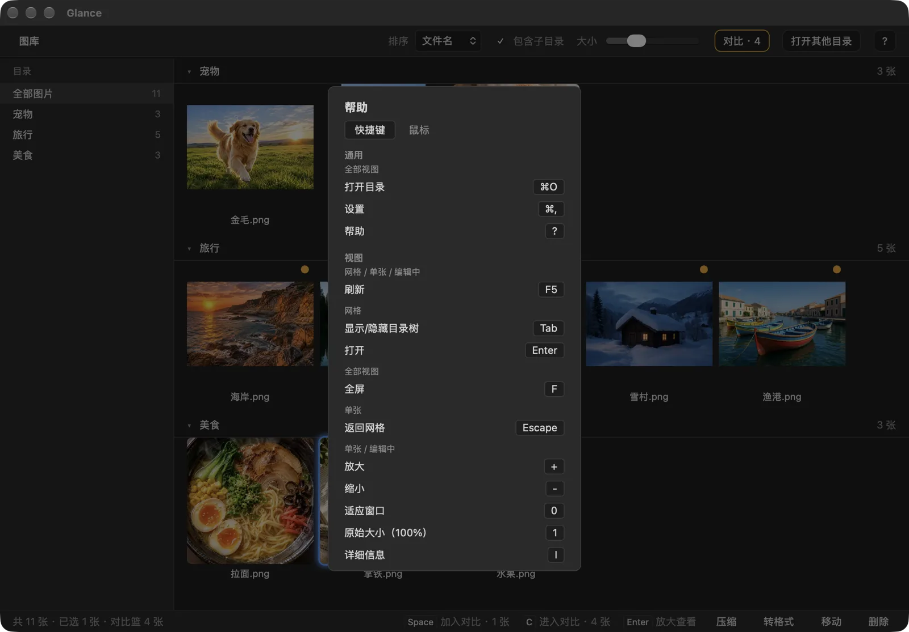

<p align="center">
  <br>
  <b>Glance</b> · 打开一个文件夹，一口气看完里面所有图片<br>
  <a href="#功能">功能</a> •
  <a href="#从源码构建">从源码构建</a>
</p>

<p align="center">
  <a href="https://github.com/huxiaohei/Glance/actions/workflows/ci.yml"></a>
  
  
  
</p>

到 [Releases](https://github.com/huxiaohei/Glance/releases/latest) 下载：macOS 用 `.dmg`（Apple 芯片与 Intel 通用，macOS 12 及以上），Windows 用 `-setup.exe`（Windows 10 及以上）。之后有新版本时，应用会提示更新。

## 为什么做 Glance

整理照片、挑设计稿、翻素材库、核对截图时，你要的是“把这个文件夹里的图都过一遍”，而系统自带的看图工具是按“一张图”设计的：

- **双击一张、关掉、再开下一张。** 子目录里的图更麻烦，得一层层点进去。
- **一大堆图第一次打开很慢**，缩略图要等，大图切换要转圈。
- **看到不要的图想顺手删掉、改名、挪个地方**，得切回访达或资源管理器，回来又找不到看到哪了。

Glance 把“文件夹”当成看图的单位：打开一次，里面（包括子目录）所有图片按目录分组排好，网格里扫一眼，回车放大，左右键翻页，看到哪处理到哪。

## 功能

<p align="center"></p>

- **按文件夹看图**：打开一次，包括子目录在内的所有图片按目录分组排成缩略图网格；目录树跳转、排序，文件夹里新增、删除、改名的图自动跟上。可以把文件夹拖进窗口或 Dock，也能从右键菜单“用 Glance 打开”。
- **快速翻看**：双击或回车放大，左右键翻页，相邻的图提前解码好；缩放平移、全屏、EXIF 详情。
- **顺手整理**：删除（进废纸篓）、重命名、移动 / 复制（可直接拖到目录树）、拖出窗口交给其他应用；都能撤销，遇到同名文件不覆盖。
- **并排对比**：把几张图放进对比篮并排看，同步缩放平移，拖动调整顺序，重启后仍在。
- **编辑**：压缩、转格式（JPEG / PNG / WebP）、裁剪、去背景，实时预览并显示预估大小；默认另存副本，覆盖原图也能撤销。
- **批量压缩与转格式**：选中多张一次处理，结果放进单独的文件夹、不动原图；可以随时取消，也能整批撤销。
- **本地、免费**：图片只在本机处理；支持 JPEG、PNG、WebP、GIF、BMP，以及 HEIC / HEIF / AVIF（用系统自带的解码能力，Windows 上看 HEIC 需要系统的 HEVC 视频扩展）；macOS 与 Windows，中英文界面，深色 / 浅色主题。

<table>
  <tr>
    <td></td>
    <td></td>
  </tr>
  <tr>
    <td></td>
    <td></td>
  </tr>
</table>

快捷键和鼠标操作在应用里随时可查：按 <kbd>?</kbd>，或点网格右上角的 <kbd>?</kbd>。

## 从源码构建

需要 Rust 1.95.0（`rust-toolchain.toml` 会自动选用）、Node.js 26 与 npm；macOS 12+ 装 Xcode Command Line Tools，Windows 10+ 装 Visual Studio 生成工具（MSVC）与 WebView2。

```sh
npm install
npm run tauri dev      # 开发模式
npm run tauri build    # 打包
```

macOS 的应用在 `target/release/bundle/macos/Glance.app`，Windows 的安装程序在 `target/release/bundle/nsis/`。

提交前需要通过的检查：

```sh
cargo test --workspace
cargo clippy --workspace -- -D warnings
npm test
npx tsc --noEmit
```

代码结构：`src/` 是前端（React + TypeScript），`src-tauri/` 是应用壳与后端（Rust），`crates/glance-imaging/` 是不依赖 Tauri 的图片解码与缩略图库。第三方依赖只用宽松许可，由 `cargo deny` 在 CI 里检查。

## 许可

[GPL-3.0](LICENSE)
